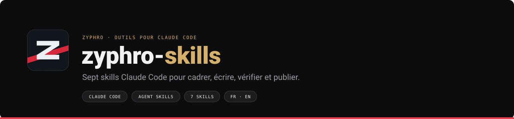
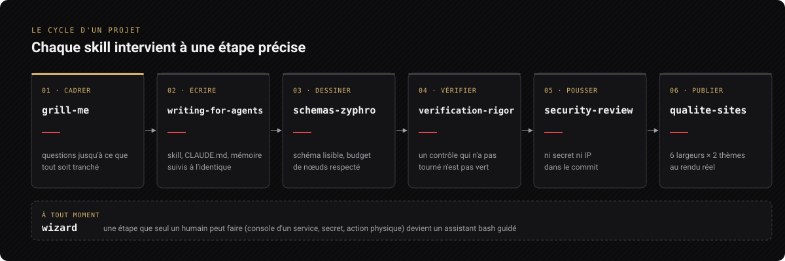
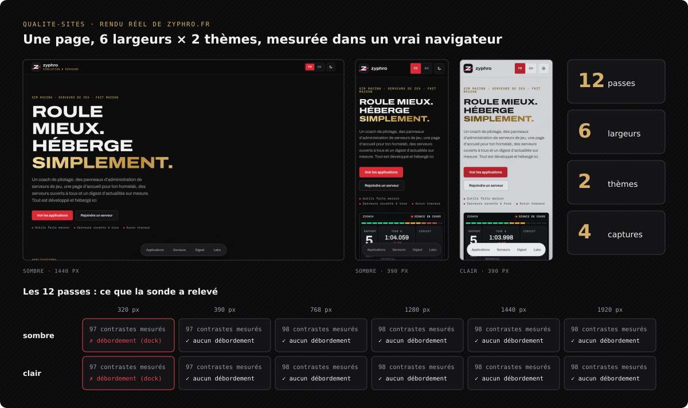
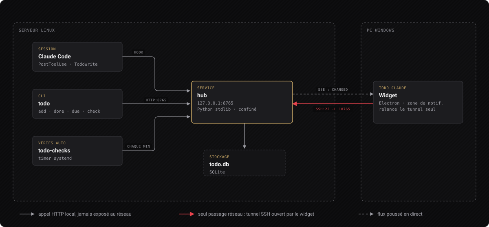
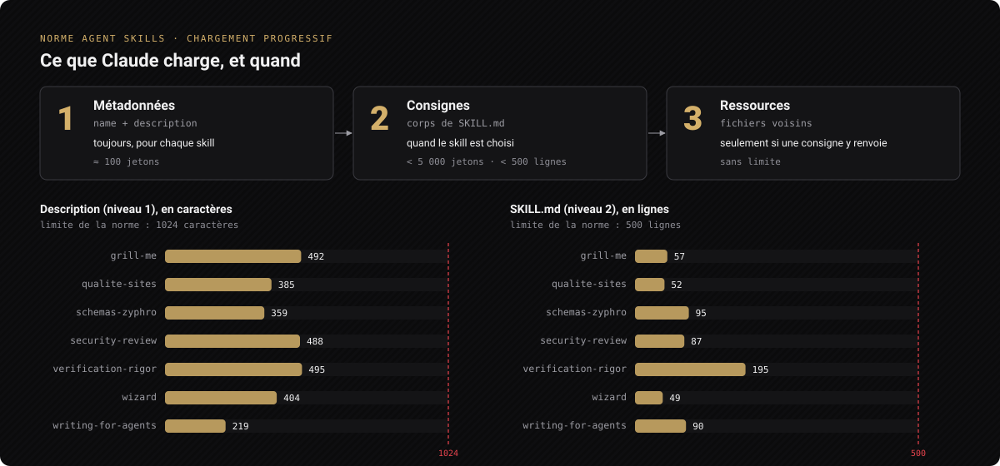

# zyphro-skills



Skills [Claude Code](https://code.claude.com/docs/en/skills) que j'utilise au quotidien pour administrer mon homelab et publier mes sites. Chaque dossier est un skill autonome au format ouvert [Agent Skills](https://agentskills.io/specification) : un `SKILL.md` (en-tête YAML + consignes en Markdown), et parfois des fichiers voisins chargés à la demande.

Ils sont publiés tels que je les utilise, sans être devenus génériques : certains citent mes chemins, ma charte graphique ou mes outils. La section [Adapter à son environnement](#adapter-à-son-environnement) liste ce qu'il faut changer.

## Sommaire

- [Les skills](#les-skills)
- [Installation](#installation)
- [Utilisation](#utilisation)
- [Adapter à son environnement](#adapter-à-son-environnement)
- [Format d'un skill (norme Agent Skills)](#format-dun-skill-norme-agent-skills)
- [Règles d'écriture suivies ici](#règles-décriture-suivies-ici)
- [Vérifier un skill](#vérifier-un-skill)
- [Sécurité](#sécurité)
- [Crédits et licence](#crédits-et-licence)

## Les skills

| Skill | À quoi il sert | Fichiers | Langue |
|---|---|---|---|
| [grill-me](grill-me/SKILL.md) | Se faire cuisiner sur un plan avant de le lancer : tours de questions numérotées, chacune avec une réponse recommandée, jusqu'à ce que toutes les décisions soient tranchées. | `SKILL.md` | FR |
| [qualite-sites](qualite-sites/SKILL.md) | Contrôler une page publique au rendu, dans un vrai navigateur : 6 largeurs × 2 thèmes, contraste, focus, débordements, cibles tactiles, premier écran. | `SKILL.md`, `REGLES.md`, `MANUEL.md`, `rendu.py`, `sonde.js`, `test_sonde.py` | FR |
| [schemas-zyphro](schemas-zyphro/SKILL.md) | Dessiner un schéma d'architecture lisible (réseau, flux, déploiement, séquence) en SVG ou en Mermaid : budget de nœuds, connecteurs, frontières de confiance. | `SKILL.md` | FR |
| [security-review](security-review/SKILL.md) | Contrôle anti-fuite avant un commit ou un push : secrets, topologie (IP, noms de machines), gitleaks, audit des dépendances, durcissement des conteneurs. | `SKILL.md` | EN |
| [verification-rigor](verification-rigor/SKILL.md) | Refuser qu'une vérification qui n'a pas tourné passe pour verte : revue de tests, de scripts de CI, de diffs et de rapports « c'est fait ». | `SKILL.md` | EN |
| [wizard](wizard/SKILL.md) | Générer un assistant bash pas à pas pour les étapes qu'un humain doit faire lui-même (console d'un service tiers, secret à saisir, action physique). | `SKILL.md`, `template.sh` | FR |
| [writing-for-agents](writing-for-agents/SKILL.md) | Écrire un skill, un agent, un `CLAUDE.md` ou une fiche mémoire qu'un agent suit de façon prévisible. | `SKILL.md`, `MECANIQUE-SKILLS.md` | FR |



Détail des déclencheurs : la ligne `description` en tête de chaque `SKILL.md`. C'est elle que Claude lit pour décider d'utiliser le skill.

### En images

**qualite-sites** sur la vraie page d'accueil de zyphro.fr : captures produites par `rendu.py`, matrice tirée de `resultats.json`. La passe à 320 px relève un vrai débordement du dock.



**schemas-zyphro** : schéma d'architecture dessiné en suivant le skill (zones en tirets, connecteurs orthogonaux étiquetés, un seul accent rouge sur le seul passage réseau).



### Prérequis par skill

| Skill | Ce qu'il lui faut |
|---|---|
| qualite-sites | Python 3 (bibliothèque standard seulement) et un serveur [Playwright MCP](https://github.com/microsoft/playwright-mcp) joignable en HTTP. Adresse dans la variable `PLAYWRIGHT_MCP` (défaut `http://localhost:8931/mcp`). La page à contrôler doit être joignable depuis ce serveur. |
| security-review | [gitleaks](https://github.com/gitleaks/gitleaks) et l'outil d'audit des dépendances du projet (`npm audit`, `pip-audit`…). |
| wizard | bash ; pour la partie secrets, mes commandes `secret-import` / `secret-run` (gestionnaire de mots de passe Vaultwarden), à remplacer par les vôtres. |
| les autres | Rien : ce sont des consignes en Markdown. |

## Installation

Claude Code charge les skills depuis plusieurs emplacements :

| Portée | Emplacement |
|---|---|
| Personnelle (tous vos projets) | `~/.claude/skills/<nom>/SKILL.md` |
| Projet (partagée par git avec l'équipe) | `.claude/skills/<nom>/SKILL.md` à la racine du dépôt |
| Plugin | `<plugin>/skills/<nom>/SKILL.md` |

Copier un skill (portée personnelle) :

```bash
git clone https://github.com/Zyphro3D/zyphro-skills.git
mkdir -p ~/.claude/skills
cp -r zyphro-skills/grill-me ~/.claude/skills/
```

Ou garder le clone à jour et le lier :

```bash
ln -s "$PWD/zyphro-skills/grill-me" ~/.claude/skills/grill-me
```

Le nom du dossier doit rester celui du skill (champ `name`). Les noms `synced` et `anthropic-skills` sont réservés par Claude Code dans `~/.claude/skills/`.

Les skills sont aussi utilisables ailleurs que dans Claude Code (claude.ai, API Skills, autres agents compatibles Agent Skills) : leur en-tête ne contient que des champs de la norme.

## Utilisation

- **Automatique** : Claude lit les descriptions de tous les skills installés et charge celui qui correspond à la demande (« vérifie la page avant de publier » → `qualite-sites`).
- **À la main** : taper `/nom-du-skill` dans Claude Code, par exemple `/grill-me`.
- Vérifier qu'un skill est vu : taper `/` dans Claude Code, il apparaît dans la liste ; ou demander « quels skills as-tu ? ».

Exemple pour `qualite-sites`, lancé à la main hors de Claude :

```bash
PLAYWRIGHT_MCP=http://localhost:8931/mcp \
  python3 -I ~/.claude/skills/qualite-sites/rendu.py https://exemple.fr ./rendu-exemple
python3 -I ~/.claude/skills/qualite-sites/test_sonde.py   # code 0 = la sonde détecte tous les défauts injectés
```

## Adapter à son environnement

| Skill | À changer |
|---|---|
| tous | Le prénom « Florian » désigne l'humain qui pilote : le remplacer par « l'utilisateur » ou le vôtre. |
| qualite-sites | La liste des sites dans la `description`, et `REGLES.md` si votre charte diffère (couleurs, polices). |
| schemas-zyphro | Les exemples d'infrastructure (Proxmox, pare-feu, Cloudflare → Caddy) et le chemin de la charte `~/dev/zyphro-brand/CHARTE.md`. |
| wizard | Les chemins `~/ops/wizards/`, `~/ops/.secrets/`, `~/ops/docs/runbooks.md`, et les fonctions de secrets de `template.sh`. |
| writing-for-agents | Les exemples tirés de mon environnement (`~/ops/CLAUDE.md`, `journal.md`) : les règles restent valables telles quelles. |
| security-review, grill-me | Les renvois vers des skills non publiés ici (`security-audit`, `homelab-audit-infra`, `llm-council`) : les retirer ou les remplacer. |
| verification-rigor | Rien d'obligatoire ; les incidents cités en exemple viennent de mon homelab. |

Après modification, garder la `description` courte et précise : c'est la seule partie chargée en permanence.

## Format d'un skill (norme Agent Skills)

Résumé de la [spécification Agent Skills](https://agentskills.io/specification) et de la [documentation des skills de Claude Code](https://code.claude.com/docs/en/skills). Tous les skills de ce dépôt la respectent.

### Arborescence

```
nom-du-skill/
├── SKILL.md       obligatoire : en-tête YAML + consignes
├── scripts/       facultatif : code exécutable (Python, Bash, JavaScript…)
├── references/    facultatif : documentation lue à la demande
├── assets/        facultatif : modèles, images, données
└── …              tout autre fichier est permis
```

Ici, les fichiers voisins sont posés directement à côté de `SKILL.md` (`REGLES.md`, `template.sh`…) : la norme l'autorise, les sous-dossiers ne sont qu'une recommandation.

### En-tête (frontmatter)

```markdown
---
name: nom-du-skill
description: Ce que fait le skill et quand l'utiliser, avec les mots qui doivent le déclencher.
---

# Consignes en Markdown
```

Champs de la norme :

| Champ | Obligatoire | Contraintes |
|---|---|---|
| `name` | oui | 1 à 64 caractères ; minuscules `a-z`, chiffres et tirets ; pas de tiret au début, à la fin ni en double ; identique au nom du dossier. |
| `description` | oui | 1 à 1 024 caractères, non vide. Dit ce que fait le skill **et** quand l'utiliser, avec des mots-clés concrets. |
| `license` | non | Nom de licence ou renvoi vers un fichier fourni. |
| `compatibility` | non | 1 à 500 caractères : exigences d'environnement (outils, accès réseau, produit visé). |
| `metadata` | non | Table libre clé → valeur (chaînes). |
| `allowed-tools` | non | Expérimental : outils pré-autorisés, séparés par des espaces (`Bash(git:*) Read`). |

Claude Code accepte en plus des champs propres (`disable-model-invocation`, `user-invocable`, `argument-hint`, `model`, `effort`, `context: fork`, `agent`, `hooks`, `paths`…). Ils sont refusés à l'envoi sur claude.ai ou par l'API Skills : ce dépôt n'en utilise aucun pour rester portable.

### Chargement progressif



1. **Métadonnées** (~100 jetons) : `name` et `description` de chaque skill, chargés au démarrage.
2. **Consignes** (moins de 5 000 jetons conseillés) : le corps de `SKILL.md`, chargé quand le skill est activé. La norme conseille moins de 500 lignes.
3. **Ressources** : les fichiers voisins, lus seulement quand une consigne y renvoie.

Les renvois se font en chemin relatif depuis la racine du skill (`[règles](REGLES.md)`), sur un seul niveau de profondeur.

## Règles d'écriture suivies ici

Elles viennent du skill [writing-for-agents](writing-for-agents/SKILL.md) ; en bref :

- **La description est un pointeur** : mot directeur en tête, un déclencheur par cas traité, pas de synonymes qui répètent le même cas. Elle coûte des jetons à chaque tour, elle est élaguée en premier.
- **Étapes, puis référence** : ce que l'agent fait, dans l'ordre, reste dans `SKILL.md` ; la référence utile à un seul cas part dans un fichier voisin.
- **Chaque étape finit sur un critère de fin** vérifiable (« 12 passes et 4 captures », pas « page comprise »).
- **Consignes en positif** : on décrit la cible ; un interdit n'apparaît que comme garde-fou dur, accompagné de la cible.
- **Une source de vérité** : rien de recopié de l'environnement que l'agent peut lire lui-même (configs, `--help`).
- **Pas de consigne que le modèle suit déjà** par défaut.
- **Sources citées** : un passage repris d'un autre projet porte en tête son dépôt, son commit et sa licence.

## Vérifier un skill

- Conformité de l'en-tête à la norme : l'outil de référence [skills-ref](https://github.com/agentskills/agentskills/tree/main/skills-ref) (`skills-ref validate ./nom-du-skill`).
- Script fourni : son test quand il en a un (`qualite-sites/test_sonde.py`).
- En situation : formuler une demande qui doit déclencher le skill et vérifier que Claude le charge, puis une demande voisine qui ne doit **pas** le déclencher.

## Sécurité

Un skill est un texte que l'agent suit avec vos droits : accès aux fichiers, au shell, au réseau. Avant d'installer un skill, de ce dépôt ou d'ailleurs :

- lire `SKILL.md` **et** chaque script en entier ;
- repérer les commandes réseau, les écritures hors du dossier de travail, les hooks ajoutés aux réglages ;
- préférer une copie relue et figée à un outil d'installation qui met à jour tout seul.

Aucun script de ce dépôt n'envoie de données à un service tiers. `qualite-sites/rendu.py` ne parle qu'au serveur Playwright dont vous donnez l'adresse ; `test_sonde.py` lui fait ouvrir `https://zyphro.fr/`. `wizard/template.sh` contient une étape d'exemple vers `exemple.com`, à remplacer par la vôtre.

## Crédits et licence

Les skills sont sous licence [PolyForm Noncommercial 1.0.0](LICENSE.md) : usage personnel, étude et modification libres ; usage commercial interdit.

Plusieurs adaptent des règles publiées par d'autres sous licence MIT ou Apache-2.0 (mattpocock/skills, obra/superpowers, github/spec-kit, BMAD-METHOD, jakubkrehel/skills, nutlope/hallmark, taste-skill, diagram-design, archify). Ces parties gardent leur licence d'origine et chaque fichier cite sa source en tête : détail dans [THIRD-PARTY.md](THIRD-PARTY.md).
